<!-- Generated by scripts/build_profile.py. Edit the generator and data sources. -->

<picture><source media="(max-width: 600px)" srcset="assets/hero-mobile.svg" />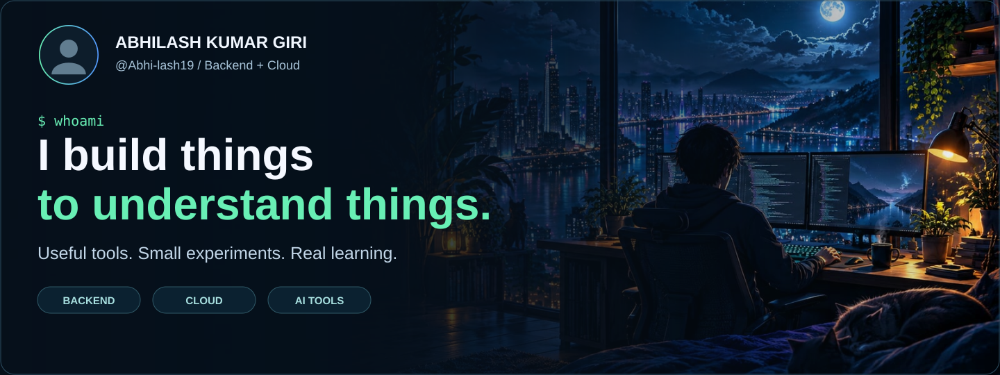</picture>

<picture><source media="(max-width: 600px)" srcset="assets/stats/summary-mobile.svg" />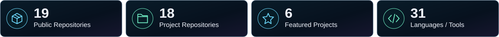</picture>

<picture><source media="(max-width: 600px)" srcset="assets/mindset-mobile.svg" />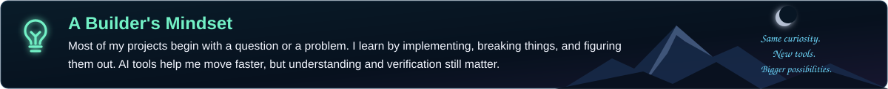</picture>

### ✧ Featured Projects

<picture><source media="(max-width: 600px)" srcset="assets/projects/bountydesk-mobile.svg" />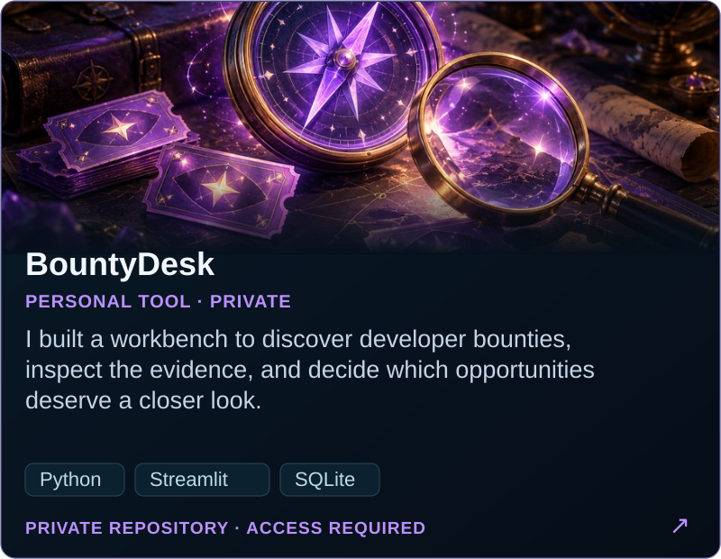</picture>
<picture><source media="(max-width: 600px)" srcset="assets/projects/chitragupta-mobile.svg" />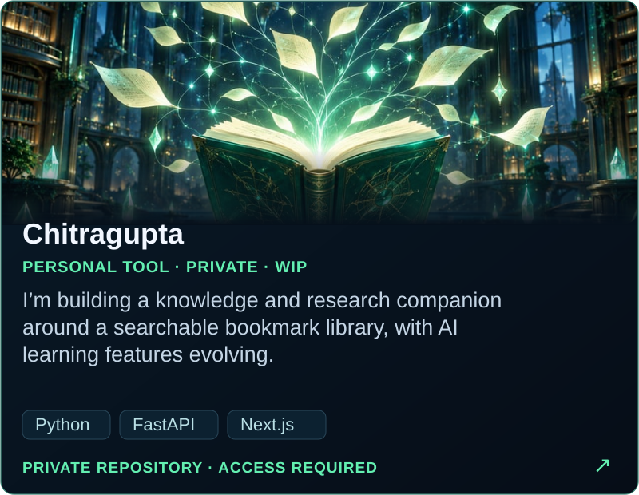</picture>
<a href="https://github.com/Abhi-lash19/Renzo"><picture><source media="(max-width: 600px)" srcset="assets/projects/renzo-mobile.svg" />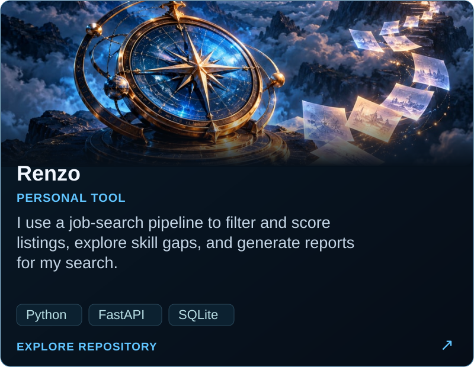</picture></a>
<a href="https://github.com/Abhi-lash19/ScribeAI"><picture><source media="(max-width: 600px)" srcset="assets/projects/scribeai-mobile.svg" />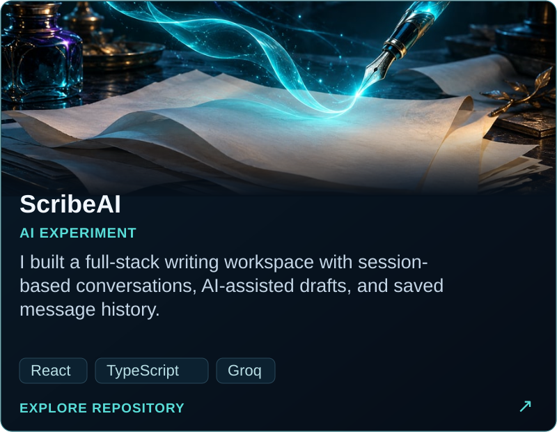</picture></a>
<a href="https://github.com/Abhi-lash19/CoreGPT"><picture><source media="(max-width: 600px)" srcset="assets/projects/coregpt-mobile.svg" />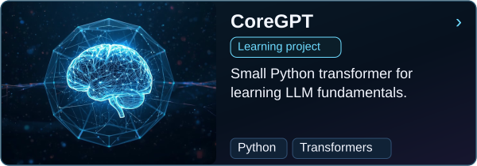</picture></a>
<a href="https://github.com/Abhi-lash19/GitInsight_Engine"><picture><source media="(max-width: 600px)" srcset="assets/projects/gitinsight-mobile.svg" />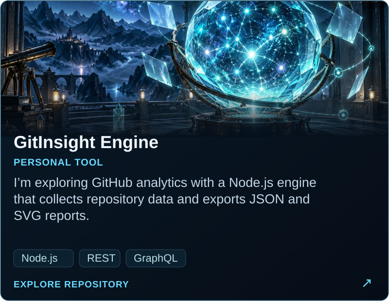</picture></a>

### ◇ More to Explore

<a href="https://github.com/Abhi-lash19/VERA"><picture><source media="(max-width: 600px)" srcset="assets/projects/vera-mobile.svg" />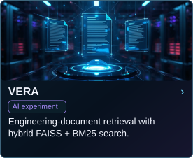</picture></a>
<a href="https://github.com/Abhi-lash19/Kagaya"><picture><source media="(max-width: 600px)" srcset="assets/projects/kagaya-mobile.svg" />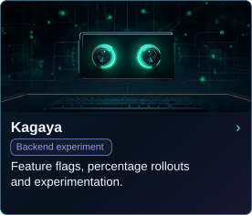</picture></a>
<a href="https://github.com/Abhi-lash19/edututor-core"><picture><source media="(max-width: 600px)" srcset="assets/projects/edututor-mobile.svg" />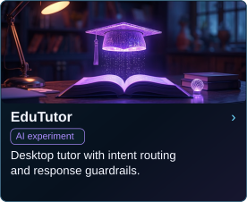</picture></a>
<a href="https://github.com/Abhi-lash19/express-typescript-backend"><picture><source media="(max-width: 600px)" srcset="assets/projects/express-mobile.svg" />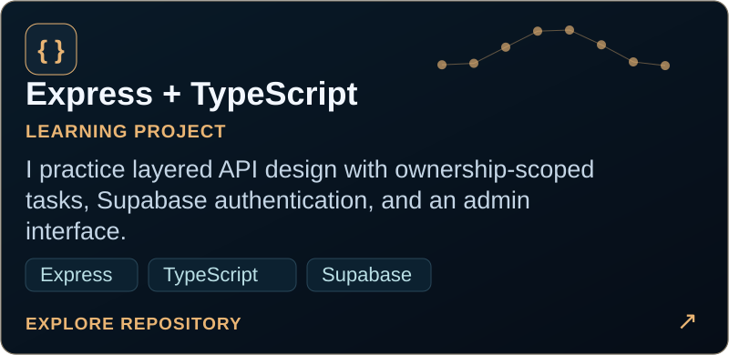</picture></a>
<a href="https://github.com/Abhi-lash19/3d-portfolio"><picture><source media="(max-width: 600px)" srcset="assets/projects/portfolio-mobile.svg" />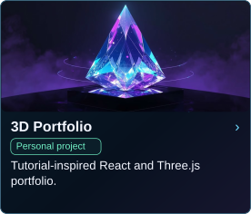</picture></a>
<a href="https://github.com/Abhi-lash19/MonitorPro"><picture><source media="(max-width: 600px)" srcset="assets/projects/monitorpro-mobile.svg" />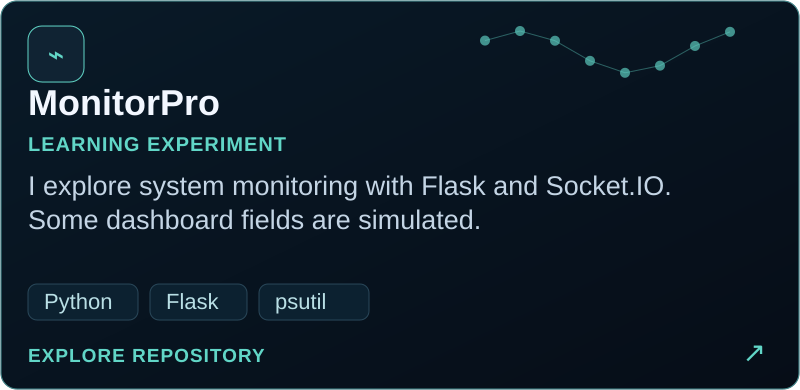</picture></a>

### ↦ How I Build

<picture><source media="(max-width: 600px)" srcset="assets/workflow-mobile.svg" />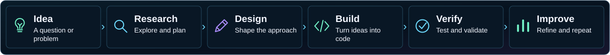</picture>

### ◈ Tech Stack

<picture><source media="(max-width: 600px)" srcset="assets/tech/stack-mobile.svg" /></picture>

### ▥ GitHub Insights

<picture><source media="(max-width: 600px)" srcset="assets/stats/commits-mobile.svg" />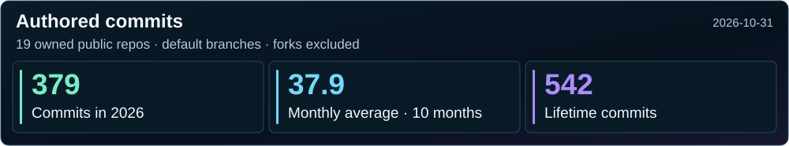</picture>

<a href="docs/METRICS.md"><picture><source media="(max-width: 600px)" srcset="assets/stats/languages-mobile.svg" />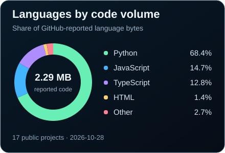</picture></a>
<a href="docs/METRICS.md"><picture><source media="(max-width: 600px)" srcset="assets/stats/repositories-mobile.svg" />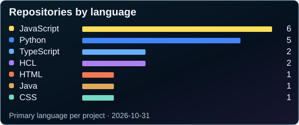</picture></a>

### ↝ Contribution Journey

<picture>
  <source media="(prefers-reduced-motion: reduce)" srcset="https://raw.githubusercontent.com/Abhi-lash19/Abhi-lash19/output/github-contribution-grid-snake-dark.svg#reduced-motion" />
  
</picture>

<picture><source media="(max-width: 600px)" srcset="assets/footer-mobile.svg" />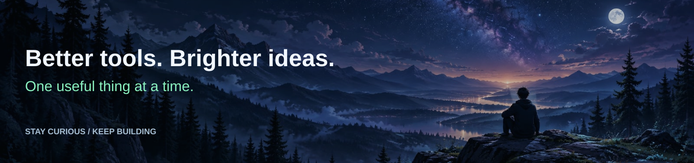</picture>
