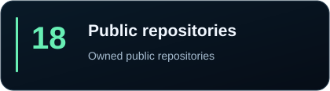
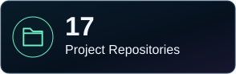
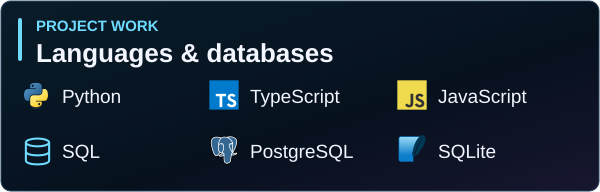
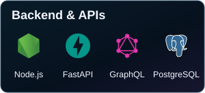
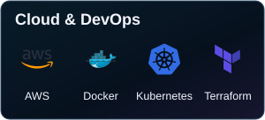
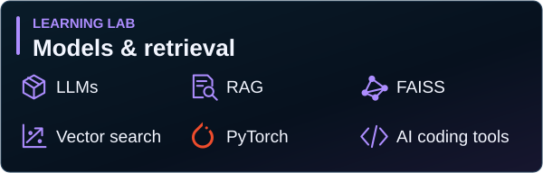
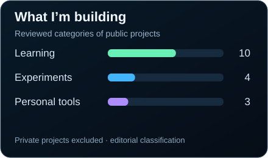
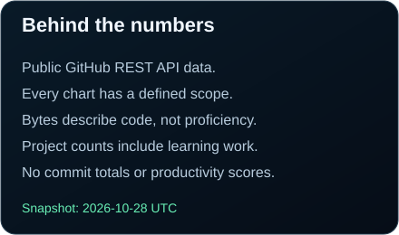

<!-- Generated by scripts/build_profile.py. Edit data/projects.json or the generator. -->
<picture>
  <source media="(max-width: 600px)" srcset="assets/hero-mobile.svg" />
  
</picture>

<h1>Abhilash Kumar Giri</h1>

I’m a backend and cloud developer who learns by building real things. Right now, I’m exploring AI-assisted software engineering, coding agents, and useful personal tools. Most of my GitHub is personal work, engineering experiments, and learning projects. I’m still early in contributing to open source.

<a href="https://github.com/Abhi-lash19">GitHub</a> · <a href="https://abhi-lash19.github.io/3d-portfolio/">Portfolio</a> · <a href="https://linkedin.com/in/abhilash-giri">LinkedIn</a> · <a href="mailto:abhilashkumargiri63@gmail.com">Email</a>

  
  

<h2>A builder's mindset</h2>

I like turning ideas and everyday problems into working tools. Implementing a concept helps me see what I understand and what I still need to learn. Before I build, I research existing solutions and decide what is actually worth making.

I’m curious about how AI coding tools can help me work better. Requirements, understanding the code, testing, and verification still matter. I care more about learning something real and getting useful software working than collecting badges.

<h3>How I build</h3>

<strong>Idea → Research → Design → Build → Verify → Improve</strong>

<h2>✦ Featured projects</h2>

Personal tools and experiments from my workbench. The artwork is conceptual, not a product screenshot. **Private** repositories require access; **WIP** means work in progress.

  
  
  
  
  
  

Read project descriptions and technology details

**[BountyDesk](https://github.com/Abhi-lash19/BountyDesk)** · Personal tool · Private

I built a workbench to discover developer bounties, inspect the evidence, and decide which opportunities deserve a closer look. *Python, Streamlit, SQLite.*

**[Chitragupta](https://github.com/Abhi-lash19/chitragupta)** · Personal tool · Private · WIP

I’m building a knowledge and research companion around a searchable bookmark library, with AI learning features evolving. *Python, FastAPI, Next.js.*

**[Renzo](https://github.com/Abhi-lash19/Renzo)** · Personal tool

I use a job-search pipeline to filter and score listings, explore skill gaps, and generate reports for my search. *Python, FastAPI, SQLite.*

**[ScribeAI](https://github.com/Abhi-lash19/ScribeAI)** · AI experiment

I built a full-stack writing workspace with session-based conversations, AI-assisted drafts, and saved message history. *React, TypeScript, Groq.*

**[CoreGPT](https://github.com/Abhi-lash19/CoreGPT)** · Learning project

I explore tokenization, attention, and transformer building blocks through a small Python implementation. *Python, Transformers.*

**[GitInsight Engine](https://github.com/Abhi-lash19/GitInsight_Engine)** · Personal tool

I’m exploring GitHub analytics with a Node.js engine that collects repository data and exports JSON and SVG reports. *Node.js, REST, GraphQL.*

<h2>◇ More to explore</h2>

  
  
  
  
  
  

Read project descriptions and technology details

**[VERA](https://github.com/Abhi-lash19/VERA)** · AI experiment

I’m exploring engineering-document retrieval with a terminal interface and hybrid FAISS + BM25 search. *Python, FAISS, BM25.*

**[Kagaya](https://github.com/Abhi-lash19/Kagaya)** · Backend experiment

I’m exploring feature flags and experimentation through a GraphQL API, flag management, and percentage rollouts. *TypeScript, Fastify, Prisma.*

**[EduTutor](https://github.com/Abhi-lash19/edututor-core)** · AI experiment

I built a desktop tutor experiment with intent routing, response guardrails, and saved conversations. *Python, PySide6, SQLite.*

**[Express + TypeScript](https://github.com/Abhi-lash19/express-typescript-backend)** · Learning project

I practice layered API design with ownership-scoped tasks, Supabase authentication, and an admin interface. *Express, TypeScript, Supabase.*

**[3D Portfolio](https://github.com/Abhi-lash19/3d-portfolio)** · Personal project

I customized a tutorial-inspired portfolio with React, Three.js, and motion experiments. *React, Three.js.*

**[MonitorPro](https://github.com/Abhi-lash19/MonitorPro)** · Learning experiment

I explore system monitoring with Flask and Socket.IO. Some dashboard fields are simulated. *Python, Flask, psutil.*

<h2>⟡ Learning Lab</h2>

Earlier backend, cloud, deployment, and browser projects. These are learning work, not claims of production services.

- **[Python-FastApi-AWS](https://github.com/Abhi-lash19/Python-FastApi-AWS)** · Wikipedia API, Python CLI, and container delivery experiments on AWS.
- **[infra-deploy-aws](https://github.com/Abhi-lash19/infra-deploy-aws)** · Terraform, EC2, Docker, and deployment workflow practice.
- **[jenkins-eks-automation](https://github.com/Abhi-lash19/jenkins-eks-automation)** · Jenkins infrastructure and EKS provisioning with Terraform.
- **[register-app-java](https://github.com/Abhi-lash19/register-app-java)** · Maven modules, a JSP registration form, and container packaging. *Tutorial-guided.*
- **[apollo-graphql-federation-demo](https://github.com/Abhi-lash19/apollo-graphql-federation-demo)** · Apollo Odyssey Lift-off coursework with starter and final examples. *Tutorial-guided.*
- **[favathlete](https://github.com/Abhi-lash19/favathlete)** · An Express endpoint, tests, and Kubernetes deployment practice. *Learning assignment.*
- **[x-o-game](https://github.com/Abhi-lash19/x-o-game)** · Browser tic-tac-toe with turn handling, win detection, and reset.

<h2>⌘ Technology stack</h2>

Tools I use and explore, with different levels of familiarity. The stack reflects these repositories, not equal expertise in everything shown.

  
  
  
  

<h2>▥ GitHub insights</h2>

These panels use a saved public GitHub API snapshot. Language bytes measure the code GitHub detects, not skill or time spent.

  
  
  
  

[Sources, definitions, and limitations](docs/METRICS.md) · [Raw snapshot](data/github-stats.json) · [Accessible chart values](data/stats-summary.json)

<h2>↝ Contribution journey</h2>

An animated snake moving through my actual GitHub contribution grid. A small reminder to keep showing up and learning.

<picture>
  <source media="(prefers-reduced-motion: reduce)" srcset="assets/snake-static.svg" />
  
</picture>

Snake snapshot and animation fallback

The live image above comes from the existing output branch. If that image is unavailable, this bundled animated snapshot remains available. The snapshot is dated in the asset notes and is not a live activity report.

<h2>Let’s connect</h2>

I’m happy to talk about a useful tool, a backend problem, or something you’re learning. Better tools and a little more understanding: that’s what I’m working toward.

<a href="https://github.com/Abhi-lash19">GitHub ↗</a> &nbsp; · &nbsp; <a href="https://abhi-lash19.github.io/3d-portfolio/">Portfolio ↗</a> &nbsp; · &nbsp; <a href="https://linkedin.com/in/abhilash-giri">LinkedIn ↗</a> &nbsp; · &nbsp; <a href="mailto:abhilashkumargiri63@gmail.com">Email ↗</a>

